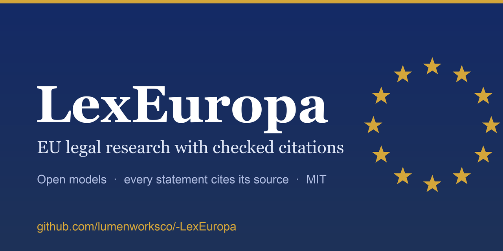

# LexEuropa

[](https://github.com/lumenworksco/-LexEuropa/actions/workflows/ci.yml)
[](LICENSE)

[](https://lex.braunf.com/)
[](https://huggingface.co/iPwnds/lexeuropa-qwen3b-merged-v4)

[](https://lex.braunf.com/)

**An open-model AI legal research assistant for EU law, with every citation verified.** [Try the interface](https://lex.braunf.com/demo/#example) (a static demo with a built-in example answer) · [project page](https://lex.braunf.com/)

LexEuropa runs on models published on Hugging Face (a LoRA-tuned [Qwen2.5-3B generator](https://huggingface.co/iPwnds/lexeuropa-qwen3b-merged-v4) served from an Inference Endpoint), so nothing heavy lives on your machine. It fetches real EU legal texts from the Publications Office CELLAR service, chunks them at article/paragraph granularity, retrieves with a hybrid BM25 + dense + exact-reference pipeline, generates an answer as structured *claims with citations*, and then **checks every citation against what was actually retrieved**. Each claim in the answer carries a label: `supported`, `interpretative`, `analysis`, `unsupported` or `uncertain`.

> Not legal advice. This is a research prototype; its output does not replace a qualified legal professional.

## Using it

**Web interface** (recommended): from the project folder, with the environment activated,

```bash
python3 -m lexeuropa.cli serve
```

opens http://127.0.0.1:8765. It is built for reading and checking, not just asking: the answer is set as numbered statements in a single column, each carrying citation numbers; select one and the exact passage it relies on opens in a **Sources panel** beside the answer (with a link to the full document on EUR-Lex), so you can compare the claim with the law. Labels (supported, interpretative, not supported, ...) are small and quiet, shown with a shape as well as a colour; reasons appear only when a statement is not fully supported. While a question runs you see the real stage it is in (finding provisions, writing, checking relevance, second opinion, checking citations), and a notice appears when the system could not confirm that the answer addresses your question. It keeps a local history, can copy an answer with its sources, prints cleanly, follows your light/dark setting, and works on narrow screens. "See an example answer" shows the format without calling any model. It runs only on your computer (it refuses connections that are not to localhost) and needs no extra packages. The first question after the model has been idle takes a minute or two.

**Command line:** `python3 -m lexeuropa.cli ask "..."` (add `--json` for machine-readable output).

## How it works

```
question
  → reference resolver ("Art. 17(1) GDPR", "C-131/12")  ┐
  → BM25 keyword search                                 ├→ RRF fusion → cross-encoder rerank
  → dense search (bge-large-en-v1.5)                    ┘
  → LLM generation → { claims: [{ text, citations }] }
  → verification: existence gate (hard check) + LLM judge, per cited chunk
  → answer with per-claim labels
```

| Component | Implementation |
|---|---|
| Corpus | 81 instruments, 14,880 chunks, English only: [see below](#corpus) |
| Retrieval | `rank_bm25`, `BAAI/bge-large-en-v1.5` via HF Inference, regex/alias reference resolver, reciprocal rank fusion |
| Reranker | Optional. `BAAI/bge-reranker-v2-m3` locally on CPU if you install the `rerank` extra; otherwise the fused ranking is used |
| Generation | `Qwen2.5-3B-Instruct` + LoRA fine-tune **v4** (merged), on a scale-to-zero HF Inference Endpoint; the top articles are expanded to their other paragraphs before generation |
| Judge | stock `Qwen2.5-7B-Instruct` via HF Inference Providers, deliberately a different model from the generator |
| Verification | A cited chunk that was not retrieved is `unsupported` with no LLM call. Source-identity check catches claims naming one case but citing another. Each citation is judged independently, concurrently. |

## Quickstart

Requires Python 3.11+ and a [Hugging Face token](https://huggingface.co/settings/tokens) with Inference Providers access. Embeddings, the judge, the fallback and (by default) generation are HF-hosted calls that need account credits; set `LEXEUROPA_EMBED_BACKEND=local` to embed queries on your machine instead.

```bash
python3 -m venv .venv && source .venv/bin/activate
pip install -e ".[dev]"            # light: no torch, no local model weights
# pip install -e ".[rerank]"       # optional: local reranker and local embeddings (~3 GB)
# export LEXEUROPA_EMBED_BACKEND=local   # embed queries on this machine instead of via HF (free)
echo "HF_TOKEN=hf_..." > .env

python -m lexeuropa.cli ingest
python -m lexeuropa.cli ask "What are the conditions for erasure under Article 17 GDPR?" --instrument gdpr
```

The default generator points at the author's scale-to-zero Inference Endpoint, which needs that account's token. The model itself is public, so you can serve [`iPwnds/lexeuropa-qwen3b-merged-v4`](https://huggingface.co/iPwnds/lexeuropa-qwen3b-merged-v4) yourself (vLLM, Ollama, ...) or use a stock model:

```bash
export LEXEUROPA_LLM_BASE_URL=https://router.huggingface.co/v1
export LEXEUROPA_LLM_MODEL=Qwen/Qwen2.5-7B-Instruct
```

Tests (the offline subset needs no network or token):

```bash
python -m pytest tests/ -v -k "not full_hybrid"
```

## Corpus

81 instruments, 14,880 chunks, English only. Everything is fetched from the Publications Office CELLAR service. Every CELEX number was verified against a live fetch (the dates and titles of the later additions were read from CELLAR itself), and every parse was checked against the real article or paragraph count with no numbering gaps.

**Consolidated texts.** For the acts that have been amended since publication (ePrivacy, e-Commerce, InfoSoc, the AI Act and 16 of the later additions) the articles are read from the latest consolidated version, so amended and deleted provisions read as they do today; the recitals and annexes still come from the original text, because a consolidated text has none. The acts marked "consolidated" below were checked to differ from the original text in at least one provision. Acts with no later consolidated version are unchanged since they were adopted. Directive 95/46/EC is kept although repealed, because judgments interpret it, and is flagged as repealed in answers.

| Primary law | CELEX | chunks |
|---|---|---|
| Consolidated version of the Treaty on European Union (TEU) | 12016M/TXT | 160 |
| Consolidated version of the Treaty on the Functioning of the European Union (TFEU) | 12016E/TXT | 726 |
| Charter of Fundamental Rights of the European Union | 12016P/TXT | 91 |

| Data protection and digital law | CELEX | chunks |
|---|---|---|
| Regulation (EU) 2016/679 (General Data Protection Regulation) | 32016R0679 | 562 |
| Directive (EU) 2016/680 (Law Enforcement Directive) | 32016L0680 | 296 |
| Regulation (EU) 2018/1725 (data protection by EU institutions, bodies, offices and agencies) | 32018R1725 | 413 |
| Regulation (EU) 2022/2065 (Digital Services Act) | 32022R2065 | 519 |
| Regulation (EU) 2022/1925 (Digital Markets Act) | 32022R1925 | 358 |
| Regulation (EU) 2022/868 (Data Governance Act) | 32022R0868 | 206 |
| Regulation (EU) 2023/2854 (Data Act) | 32023R2854 | 354 |
| Directive (EU) 2022/2555 (NIS 2 Directive) | 32022L2555 | 356 |
| Regulation (EU) 2024/1689 (Artificial Intelligence Act) (consolidated 2026-07-27) | 32024R1689 | 789 |
| Directive 95/46/EC (Data Protection Directive) | 31995L0046 | 163 |
| Directive 2002/58/EC (ePrivacy Directive) (consolidated 2009-12-19) | 32002L0058 | 115 |
| Directive 2000/31/EC (e-Commerce Directive) (consolidated 2024-02-17) | 32000L0031 | 118 |
| Directive 2001/29/EC (InfoSoc Directive) (consolidated 2019-06-06) | 32001L0029 | 96 |

| Consumer and contract law | CELEX | chunks |
|---|---|---|
| Directive 2011/83/EU (Consumer Rights Directive) (consolidated 2026-09-27) | 32011L0083 | 223 |
| Directive 2005/29/EC (Unfair Commercial Practices Directive) (consolidated 2026-09-27) | 32005L0029 | 83 |
| Council Directive 93/13/EEC (Unfair Terms in Consumer Contracts) (consolidated 2022-05-28) | 31993L0013 | 29 |
| Directive (EU) 2019/770 (Digital Content and Digital Services) | 32019L0770 | 157 |
| Directive (EU) 2019/771 (Sale of Goods) (consolidated 2026-07-31) | 32019L0771 | 138 |
| Directive (EU) 2024/2853 (Product Liability Directive) (consolidated 2024-11-18) | 32024L2853 | 122 |

| Private international law and competition | CELEX | chunks |
|---|---|---|
| Regulation (EC) No 593/2008 (Rome I: law applicable to contractual obligations) (consolidated 2008-07-24) | 32008R0593 | 116 |
| Regulation (EC) No 864/2007 (Rome II: law applicable to non-contractual obligations) | 32007R0864 | 100 |
| Regulation (EU) No 1215/2012 (Brussels I Recast: jurisdiction and judgments) (consolidated 2015-02-26) | 32012R1215 | 221 |
| Council Regulation (EC) No 1/2003 (enforcement of the competition rules) (consolidated 2009-07-01) | 32003R0001 | 149 |
| Council Regulation (EC) No 139/2004 (EU Merger Regulation) | 32004R0139 | 164 |
| Directive 2014/104/EU (Antitrust Damages Directive) | 32014L0104 | 130 |

| Employment and equality | CELEX | chunks |
|---|---|---|
| Directive 2003/88/EC (Working Time Directive) | 32003L0088 | 77 |
| Directive (EU) 2023/970 (Pay Transparency Directive) | 32023L0970 | 160 |
| Directive (EU) 2024/2831 (Platform Work Directive) (consolidated 2024-11-11) | 32024L2831 | 156 |
| Council Directive 2001/23/EC (Transfers of Undertakings) (consolidated 2015-10-09) | 32001L0023 | 40 |
| Council Directive 2000/78/EC (Employment Equality Directive) | 32000L0078 | 78 |
| Council Directive 2000/43/EC (Racial Equality Directive) (consolidated 2026-06-19) | 32000L0043 | 59 |
| Directive (EU) 2019/1152 (Transparent and Predictable Working Conditions) | 32019L1152 | 112 |
| Directive (EU) 2019/1937 (Whistleblower Directive) (consolidated 2024-12-30) | 32019L1937 | 219 |

| Other areas | CELEX | chunks |
|---|---|---|
| Directive (EU) 2016/943 (Trade Secrets Directive) | 32016L0943 | 90 |
| Directive 2004/38/EC (Citizens' Rights / Free Movement Directive) (consolidated 2011-06-16) | 32004L0038 | 128 |
| Regulation (EU) 2024/1624 (Anti-Money Laundering Regulation) | 32024R1624 | 495 |
| Regulation (EU) 2023/1114 (Markets in Crypto-Assets, MiCA) (consolidated 2024-01-09) | 32023R1114 | 917 |
| Directive (EU) 2019/790 (Copyright in the Digital Single Market) | 32019L0790 | 171 |
| Regulation (EU) 2024/2847 (Cyber Resilience Act) (consolidated 2024-11-20) | 32024R2847 | 464 |
| Regulation (EU) No 604/2013 (Dublin III Regulation) (consolidated 2013-06-29) | 32013R0604 | 198 |

CJEU judgments (38), with every paragraph and the operative part (the ruling): Google Spain SL and Google Inc. (C-131/12); GC and Others (C-136/17); Maximillian Schrems (C-362/14); Data Protection Commissioner (C-311/18); Unabhängiges Landeszentrum für Datensc (C-210/16); Fashion ID GmbH & Co. KG (C-40/17); Bundesverband der Verbraucherzentralen (C-673/17); Patrick Breyer (C-582/14); Digital Rights Ireland Ltd (C-293/12); Tele2 Sverige AB (C-203/15); Peter Nowak (C-434/16); La Quadrature du Net and Others (C-511/18); UI (C-300/21); Meta Platforms Inc. and Others (C-252/21); OQ (C-634/21); Yassin Abdullah Kadi and Al Barakaat I (C-402/05); Andrea Francovich and Danila Bonifaci  (C-6/90); Gerardo Ruiz Zambrano (C-34/09); Union royale belge des sociétés de foo (C-415/93); Association Belge des Consommateurs Te (C-236/09); Slowakische Republik (C-284/16); Associação Sindical dos Juízes Portugu (C-64/16); Andy Wightman and Others (C-621/18); Thomas Pringle (C-370/12); Peter Gauweiler and Others (C-62/14); Proceedings brought by Heinrich Weiss  (C-493/17); European Commission (C-619/18); A. K. and Others (C-585/18); Asociaţia 'Forumul Judecătorilor din R (C-83/19); Intel Corp. (C-413/14); Google LLC and Alphabet Inc. (C-48/22); Vera Egenberger (C-414/16); Stadt Wuppertal (C-569/16); Mohamed Aziz (C-415/11); Árpád Kásler and Hajnalka Káslerné Ráb (C-26/13); eDate Advertising GmbH and Others (C-509/09); Konkurrensverket (C-52/09); Åklagaren (C-617/10)

Not covered: other languages, national law, Advocate General opinions, Treaty protocols and declarations, and **Strasbourg law** (the European Convention on Human Rights and European Court of Human Rights case law). The Court's HUDOC database and the Convention PDF on echr.coe.int both refuse scripted access, and this project does not work around such filters. Judgments from before about 1991, which are in capitals with the paragraph numbers run into the text, are not parsed either (so Van Gend en Loos, Costa v ENEL and Cassis de Dijon are missing).

## Evaluation

The citation tables below were measured with v1, the default until v4 was promoted; v4 on the same 25 questions scores 0.81 / 0.88 (see *Answer quality* for why it replaced v1). All rows below ran on the same retrieval over the earlier 31-instrument, 6,872-chunk corpus ( article headings indexed, at most one recital in the result list, no reranker), the same parser and the same judge (stock Qwen2.5-7B). P = share of cited sources that point at the gold article or case; R = whether at least one does.

| generator | 42 templated (P / R) | 25 natural-language (P / R) | legislation (13) | judgments (12) |
|---|---|---|---|---|
| LexEuropa v1 + fallback (previous default) | 0.95 / 0.95 | **0.86 / 0.88** | 0.81 / 0.85 | 0.91 / 0.92 |
| LexEuropa v1 alone (3B, LoRA) | 0.95 / 0.95 | 0.82 / 0.84 | 0.81 / 0.85 | 0.82 / 0.83 |
| stock Qwen2.5-7B | 0.91 / 0.98 | 0.67 / 0.88 | 0.57 / 0.92 | 0.78 / 0.83 |
| stock Qwen2.5-72B | 0.93 / 1.00 | 0.72 / 0.88 | 0.59 / 0.83 | 0.85 / 0.92 |
| stock Qwen3-235B | 0.91 / 0.98 | 0.66 / 0.92 | 0.53 / 0.92 | 0.80 / 0.92 |
| stock DeepSeek-V3 | 0.89 / 0.98 | 0.68 / 0.88 | 0.58 / 0.92 | 0.79 / 0.83 |

(Llama-3.3-70B is omitted: 13 of its 25 natural-language answers broke the JSON format.)

**The fallback.** If the fine-tuned model refuses (no cited claim) or its output cannot be parsed, the question is retried once on Qwen2.5-72B through the Hugging Face router and the answer is labelled as coming from the fallback (`LEXEUROPA_FALLBACK_LLM_MODEL=""` disables it). It fired on 1 of 25 natural questions and 0 of 42 templated ones. It exists because a live test showed v1 refusing "Can a company send marketing emails without consent?" even though all four paragraphs of ePrivacy Article 13 had been retrieved.

What this does and does not show:

- The 3B fine-tune is **more precise** than every stock model tested, including 235B-parameter ones, because it cites the single most relevant article instead of hedging across several. Its recall is about the same as the 7B and 72B, a few points below the biggest models.
- **That is partly a property of the benchmark.** Each question has one gold article, so a model that cites exactly that article scores best. The metric measures *which sources are cited*, not whether the prose answer is correct or complete, and larger models that cite several relevant provisions are penalized on precision. Treat these numbers as evidence of citation discipline, not of legal reasoning.
- n=25 for the natural-language set, so one question moves a score by about 4 points. The 42 templated questions are easy (the provision is named) and the adapters were trained on that phrasing.
- Training alone did not help. v3 (reference-style training questions) regressed; v4 (natural-language topic questions, whole-article targets) scored below v1 on citations when given the original 8 sources, and its completeness is only as good as v1's without article expansion. v4 became the default because of what it does *with* expanded articles (see *Answer quality*). v3 is not published.
- Retrieval, not generation, was the biggest lever: indexing article headings and capping recitals lifted hit@8 on 25 questions from 0.88 to 0.96 and, on 34 fresh validation questions, from 0.85 to 0.91.
- Held-out wording can still reach training through verbatim quotation (judgments quote recitals).
- A second weakness seen live: asked about risk management for high-risk AI systems, v1 quoted Recital 65 instead of the operative Article 9 even though Article 9 was retrieved.

Artifacts: [v4 merged (default)](https://huggingface.co/iPwnds/lexeuropa-qwen3b-merged-v4), [v4 adapter](https://huggingface.co/iPwnds/lexeuropa-qwen3b-lora-v4), [v1 merged](https://huggingface.co/iPwnds/lexeuropa-qwen3b-merged), [v1 adapter](https://huggingface.co/iPwnds/lexeuropa-qwen3b-lora), [v2 merged](https://huggingface.co/iPwnds/lexeuropa-qwen3b-merged-v2), [v2 adapter](https://huggingface.co/iPwnds/lexeuropa-qwen3b-lora-v2), [training dataset](https://huggingface.co/datasets/iPwnds/lexeuropa-sft) (revision tags `v2` = 506 examples used for v1/v2, `v3` = 1,680, `main` = v4's 1,402). Method and caveats: [`CLAUDE.md`](CLAUDE.md).

## Answer quality (completeness)

The citation tables above only count *which sources are cited*. To measure whether an answer is **complete and correct**, `eval/answer_quality.jsonl` has 29 questions where completeness is at stake (rules with exceptions, lists, multi-part conditions). Each of the 25 in-scope questions has a checklist of key points, written by hand and **grounded in the real provision text** (126 points; a test fails if a key phrase is not in the source), graded by a stronger model against the checklist (`eval/run_quality.py`). The judge was calibrated first: the verbatim provision scores 0.98, its first 40% scores 0.66, an unrelated provision scores 0.00. Four "trap" questions (French tax law, US law, outcome prediction, off-topic) should be declined.

| | v1, 8 sources (25 q) | v4 + same-instrument expansion (25 q) | v4 + named-law restriction (25 q) | **current default (28 q)** |
|---|---|---|---|---|
| mean completeness | 0.56 | 0.70 | 0.82 | **0.87** |
| fully complete answers | 16% | 52% | 60% | **71%** |
| right provision retrieved | 20 / 25 | 20 / 25 | 25 / 25 | **28 / 28** |
| answers contradicting the provision | 1 | 0 | 1 | **0** |
| trap questions declined | 4 / 4 | 4 / 4 | 4 / 4 | **4 / 4** |
| citation set: right source / precision / recall | 0.96 / 0.86 / 0.88 | 0.96 / 0.81 / 0.88 | 0.96 / 0.82 / 0.88 | **0.96 / 0.87 / 0.88** |

The last column also includes the judgment rulings (operative parts), a filter for articles that apply only to EU institutions, and withholding of statements that do not answer the question. The question set changed (one outdated question replaced, three case-law holdings added, 28 in scope instead of 25), so the comparison with earlier columns is approximate. n is small and each configuration was run once.

**State of the product: seven in ten answers are fully complete (from one in six); the rest miss items or conditions.** Weakest questions: DMA gatekeeper criteria (0.0), Planet49 (0.33), GDPR access, Schrems I and breach notification (about 0.5 to 0.6). A query-rewriting step fixed some of these but broke others, so it is off by default.

What was tried:

- **Whole articles as context.** Expanding the top articles to all their paragraphs raises the best achievable completeness from 0.72 to **0.83** (fully complete 44% to 80%). End to end, with the expanded articles placed *first*, our model doubled its fully-complete answers (16% to 32%) and improved citation precision / recall on the 25-question set (0.86 / 0.88 to 0.90 / 0.92), but mean completeness stayed flat (0.56 to 0.55) because the expansion pushed the right article out for three questions and, for one, produced a confidently wrong penalty from the neighbouring article. The shipped version therefore **appends** the sibling paragraphs after the ranked results and never reorders them (`LEXEUROPA_EXPAND_ARTICLES=0` disables it). Measured end to end with that final version, v1 scores 0.53 mean completeness (16% fully complete) against 0.56 before: no gain for v1, no harm.
- **Preferring the general regime over parallel ones**: no gain (ceiling 0.69), dropped.
- **A reviewer that flags incomplete answers**: it flagged 23 of 25 answers including all 4 complete ones, so it cannot discriminate; not used.
- **Naming a law focuses the search.** If a question names exactly one instrument ("under the GDPR", "the AI Act") or you choose it in the *Law* menu, retrieval searches that instrument only, because GDPR, the EU-institutions regulation and the Law Enforcement Directive have look-alike articles that otherwise displace each other (a live test of "when must a breach be reported under the GDPR?" returned the other regime's rules and cited them as "the GDPR"). All five questions in the quality set whose right provision had been missed named their law; with the restriction the right provision is retrieved for 25/25 and mean completeness rose from 0.70 to 0.82. Restricting too hard also hid court judgments for questions about case law (citation-set hit rate 0.96 to 0.84), so up to two case-law paragraphs are allowed alongside the statute; that restored 0.96 without bringing back the crowding.
- **A larger stock model**: only slightly more complete (0.62) and equally rarely fully complete, so model size is not the main lever.
- **The v4 adapter** (trained on whole-article targets that cite every paragraph) **with article expansion** is the best configuration found: 0.70 mean completeness and 52% fully complete (3x v1's), 0 flagged contradictions, all 4 trap questions declined, citation precision / recall 0.81 / 0.88 on the 25-question set. Two things matter: (1) **without expansion v4 is no better than v1** (0.56), because the gain comes from v4 actually using the extra sources, which v1 ignores; (2) expanding articles of *any* instrument (3 articles) scored higher still (0.75) but copied look-alike provisions of other regimes into answers and produced two genuine errors (a fine that applies only to EU institutions appended to the right fine; AI Act fines mixed into a GDPR answer), so expansion is restricted to the instrument of the top-ranked result. It replaced v1 under a promotion rule written before measuring; one clause (citation precision within 0.03 of v1) passed narrowly (0.811 vs 0.840 on the closest matching run, a gap of about one question at n=25). v1 remains available (`LEXEUROPA_LLM_MODEL=iPwnds/lexeuropa-qwen3b-merged`).

## Known limitations

- English only; no national law. **No Strasbourg law** (the European Convention on Human Rights and European Court of Human Rights case law): the source sites refuse automated access and this project does not work around such filters. Judgments from before about 1991 are not parsed (their paragraph numbers are run into the text), so Van Gend en Loos, Costa v ENEL and Cassis de Dijon are missing. No Advocate General opinions.
- Acts that have a later consolidated version are read from it, but an act without one is the text as adopted, so amendments made by other acts may be missing for those. Directive 95/46/EC is kept although repealed (judgments interpret it) and is flagged as such.
- Answers are often incomplete: in the quality set about three in ten are not fully complete. Treat them as a starting point and read the cited text. Weak spots seen: broad everyday questions that name no law (look-alike provisions in other acts now compete, for example the GDPR right of access), and answers that quote judgment paragraphs but miss points the ruling states (Planet49, Schrems I).
- Retrieval surfaces the right provision for about 24 of 25 natural questions on the tuned set, 31 of 34 on fresh ones and 37 of 43 on questions about the later additions; the remaining misses are mostly broad questions with no law named, or judgments quoting a statute outranking it.
- The fine-tuned model sometimes refuses when the sources do answer the question (mitigated by a fallback model, which produced 5 of 32 answers in the final quality run) and sometimes quotes a recital instead of the operative article.
- The live adapter (v4) copies the passages it is given, so irrelevant sources can leak into an answer (expansion is restricted to one instrument for this reason). It was trained on 19 instruments and three judgments, and all measurements use small question sets run once. **End-to-end quality has not yet been measured on the full 81-instrument library**; a retrain on it is prepared (`docs/V5_RUNBOOK.md`).
- The judge rarely uses the `analysis` label; treat that label as unreliable.
- Output is research assistance, not legal advice.

## Roadmap

See [`docs/VISION.md`](docs/VISION.md) for the long-term plan. Next concrete steps: the end-to-end run on the 81-instrument library and the v5 retrain under its pre-declared promotion rule, answer review beyond which sources are cited (human or rubric review), Advocate General opinions, and Strasbourg case law if a source that permits automated access can be found.

## Contributing and support

Contributions are welcome: see [CONTRIBUTING.md](CONTRIBUTING.md). Use the issue forms to report a **wrong or misleading answer** (the most useful kind of report, since it grows the evaluation sets), a bug, or a document you would like added. Security reports go through the [private advisory form](https://github.com/lumenworksco/-LexEuropa/security/advisories/new) (see [SECURITY.md](SECURITY.md)).

## Citing

GitHub's "Cite this repository" button reads [`CITATION.cff`](CITATION.cff).

## License

[MIT](LICENSE). Legal texts are © European Union, reused under the EU's [reuse policy](https://eur-lex.europa.eu/content/legal-notice/legal-notice.html).
